<!-- ============================================================
     GitHub Profile README — Dandy Al-Farisi Natanegara
     Tema mengikuti website pribadi (dandyfn.onrender.com):
     dark navy/ungu + gradasi cyan → violet → magenta
     Ganti semua "dandyfn" dengan username GitHub kamu (Ctrl+H)
     ============================================================ -->

<!-- ===== HEADER ===== -->


<p align="center">
  
</p>

<p align="center">
  <a href="https://dandyfn.onrender.com"></a>
  
</p>

---

##  About Me

```bash
dandy@linux-mint:~$ cat about.txt
```

Saya mahasiswa **Fakultas Ilmu Komputer, Universitas Brawijaya**, yang aktif mengeksplorasi
**infrastruktur jaringan** dan **rekayasa web modern**.

- 🌐 Fokus pada perancangan, konfigurasi, dan simulasi jaringan komputer
- 💻 Mempelajari web programming, manajemen database, dan sistem operasi Linux
- 📚 Creator edukasi teknologi: menulis dokumentasi lab di blog pribadi
- 🎮 Merancang game edukasi digital sebagai media pembelajaran inovatif

---

## 🎓 My Journey

| Tahun | Pendidikan |
|:--:|:--|
| 2026 – sekarang | **S2 Ilmu Komputer**, Universitas Brawijaya |
| 2023 – sekarang | **S1 Pendidikan Teknologi Informasi**, Universitas Brawijaya |


---

## ⚙️ My Skills & Tools

<p><b>COMPUTER NETWORKS</b></p>
<p>
  
  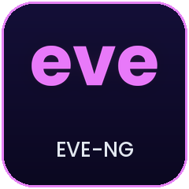
  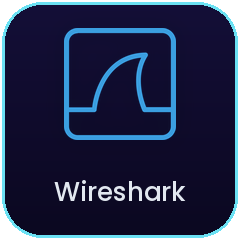
  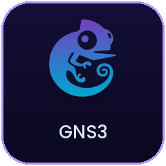
  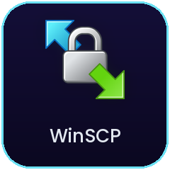
</p>

<p><b>TECH EDUCATION</b></p>
<p>
  
  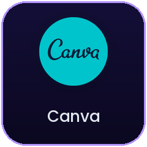
  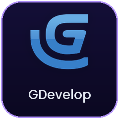
</p>

<p><b>PROGRAMMING & DATABASE</b></p>
<p>
  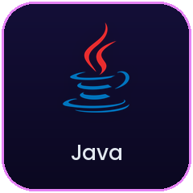
  
  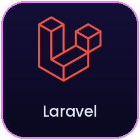
  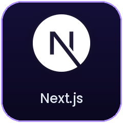
  
  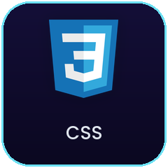
  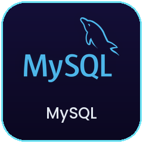
  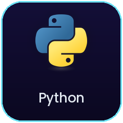
  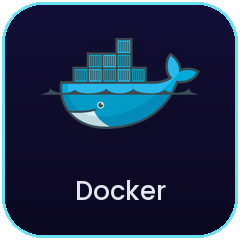
  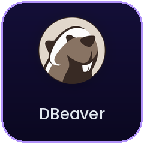
  
  
</p>

<p><b>OPERATING SYSTEM</b></p>
<p>
  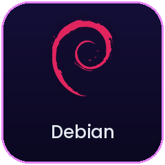
  
  
  
  
  
</p>

---

## 📊 GitHub Stats

<p align="center">
  
  
</p>

<p align="center">
  
</p>

<p align="center">
  
</p>

---

## 📡 Social Media Terminal

<p align="center">
  <a href="https://dandyfn.onrender.com"></a>
  <a href="https://wa.me/NOMOR_WA"></a>
  <a href="mailto:EMAIL_KAMU"></a>
  <a href="https://instagram.com/IG_KAMU"></a>
  <a href="https://linkedin.com/in/LINKEDIN_KAMU"></a>
</p>

```diff
+ SYSTEM SECURE // LIVE NODE  |  ON SITE : DANDY
! © 2026 Dandy — Built with Laravel on Linux Mint
```

<!-- ===== FOOTER ===== -->

